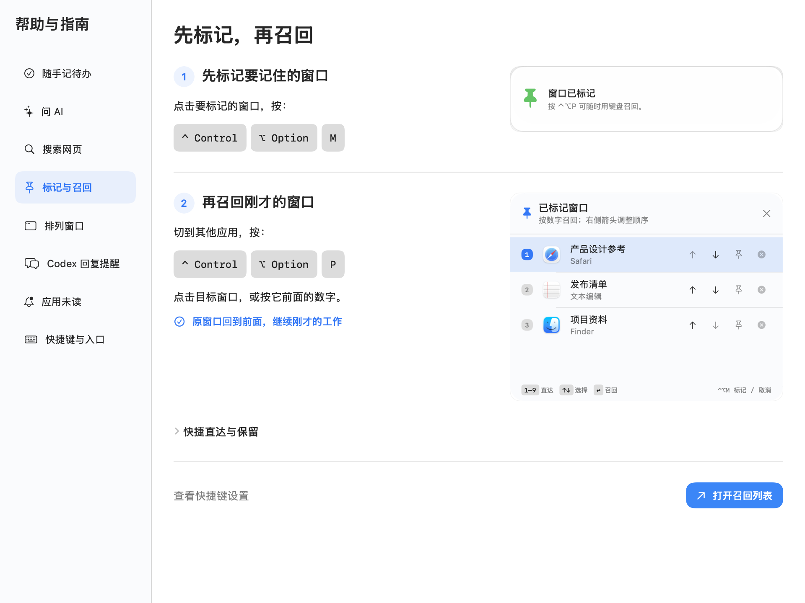

[中文](README.md) | [**English**](README.en.md)

# NARC for Mac

**Capture a thought. Ask a question. Get back to what matters.**

NARC is a lightweight Mac utility that lives in your menu bar and a floating desktop **N**. Capture a Todo, ask AI, search the web, or recover a working window without first switching to a separate workspace. While Codex is working, do something else and let NARC remind you when a reply is ready.

It has no Dock icon by default. Click the menu-bar or floating **N** for the panel, or use shortcuts to go straight to a feature.

| What you need | What NARC does |
|---|---|
| Remember something | Summon capture and press Return to create a Todo |
| Ask about current information or explain a screenshot | DeepSeek web Q&A by default; switch web search off for images, with follow-ups, streaming, and Markdown |
| Find current information | Search embedded Bing / Google; open results in your default browser |
| Stop watching an AI task | Get a Codex reply reminder and return to the conversation |
| Find a window among many | Mark it and recall it by number; arrange windows with shortcuts |

**Status: v2 development preview, not a stable release.** This README describes the current source; older installed versions may differ. Selected-text capture, multiple displays, full-screen Spaces, and target-app window compatibility still need hands-on validation.

## Install

Requires macOS 14 or later, Git, and Xcode Command Line Tools. Initial download and compilation need internet access. No Apple developer account or `sudo` is required.

### 1. Prepare the developer tools

If you do not already have them, run this in Terminal and follow the system instructions:

```bash
xcode-select --install
```

Skip this step if the tools are installed.

### 2. Download and install

This installs the v2 preview described here. Paste it into Terminal:

```bash
git clone --branch feat/ai-search-preview --single-branch https://github.com/MickMi/narc_for_mac.git && cd narc_for_mac && bash scripts/install.sh
```

The script builds on your Mac, prepares a local signing identity, installs to `~/Applications/NARC.app`, and launches NARC. You can close Terminal afterward.

Already have the source? Run `bash scripts/install.sh` from the repository instead of cloning it again.

NARC is source-only: no DMG, PKG, or prebuilt App download. A new installation creates a local self-signing identity and updates reuse it; an eligible existing NARC identity is preserved. The private key stays on your Mac and is not uploaded or distributed with the source.

### 3. Find NARC

- Click the menu-bar or floating desktop **N** to open the panel. You can drag the widget.
- Right-click **N**, or use **More (更多)** in the panel, to open **Help & Guides (帮助与指南)**. Each feature has steps and direct links to its tools or setup. Settings are also in More.
- Features introduce themselves when first opened. View instructions opens the matching chapter; Got it remembers dismissal for that feature. You do not have to complete every guide at once.
- Cannot find it? Search for **NARC** in Spotlight, or run `open ~/Applications/NARC.app`. No Dock icon is expected.

## Get started

These are defaults. Edit them under **Preferences → Shortcuts (快捷键)**. Existing custom bindings are preserved; use the actual combination and enabled status shown in Preferences.

`⌃` = Control, `⌥` = Option, `⇧` = Shift, `⌘` = Command.

| Shortcut | Action |
|---|---|
| `⌃⌥Q` | Capture a Todo |
| `⌃⌥D` | Ask AI |
| `⌃⌥B` | Bing search |
| `⌃⌥G` | Google search |
| `⌃⌥N` | Summon the widget and panel to the display under your pointer |
| `⌃⌥T` | Create a Todo from text selected in another app |
| `⌃⌥M` | Mark / unmark the current window |
| `⌃⌥P` | Open the marked-window switcher |
| `⌃⌥1–9` | Recall marked windows 1–9 directly |

### Capture Todos without sorting first

Press `⌃⌥Q`, type a task, and press Return to save a Todo. The panel's Todo page also lets you capture, edit, complete, restore, or delete tasks.

Select text in another app and press `⌃⌥T` to capture it. Long selections require confirmation. This depends on the target app exposing a readable selection; scanned images and some app surfaces are unsupported.

Set daily review times under **Preferences → Reminders (提醒)**. NARC must remain running; these do not sync to Apple Reminders. Legacy Inbox records merge into Todos. Existing Notes are retained, but the empty Notes tab is hidden when there are no notes.

### Ask AI or search the web: one window, three separate modes

Press `⌃⌥D`, or click **Ask AI (问 AI)** at the top of the floating panel, to open **NARC Search**. Switch between DeepSeek, Bing, and Google without going through Assistant.

**Set up AI first:**

1. Open **Preferences → Instant Questions (即时问答)**, enter your own DeepSeek API Key, and save it.
2. If the status says the key has not been authorized for reading, click **Authorize Key Reading (授权读取密钥)**. macOS presents a Keychain prompt only when needed. Authorization sends no AI request.
3. Once the key is ready, ask a question or use **Verify Connection (验证连接)**. Verification sends one basic Flash request and may consume quota; test web search by asking a question in the Q&A window.

AI requests use your DeepSeek account and are billed by the provider. With web search enabled, NARC uses `deepseek-v4-pro` and native `web_search`, with model and search charges. With it disabled, NARC uses `deepseek-flash` for text and images. Both use the same Key; no separate search Key is needed.

**In everyday use:**

- Summon AI and type immediately. Press `⌘Return` or click Send. Answers appear incrementally, render Markdown, and support follow-up questions.
- Click **Stop (停止)** during a long answer to keep the text received so far. If an answer reaches its per-round limit, ask it to continue.
- The **Web Search (联网)** switch starts on, is shared with Preferences, and remembers your choice. Enabled requests require native search. **Searched the Web (已搜索网页)** appears only after the server confirms search completion; returned source links are displayed and saved. Search failures preserve partial text and never silently fall back to ordinary Q&A.
- Paste clipboard images with `⌘V` in the input, or use the paperclip inside it to choose a file. Click a thumbnail to enlarge it; Esc or Done returns to the composer.
- Pro currently does not support images. Choose **Switch to Image Q&A (切换到图片问答)** to explicitly turn web search off and use Flash; your draft and attachment remain. You can turn web search back on afterward.
- An image belongs to one round only: successful completion removes it; failure preserves it for retry. Later text questions retain conversation context but do not resend that image. Add it again to analyze it again.
- **Save This Conversation (保存本次对话)** saves all text turns. **Copy This Answer (复制本轮回答)** copies only the latest AI answer. Images are not saved with the conversation.
- **Clear Current (清空当前)** clears the current session, not saved records. Closing the search window also clears unsaved questions and answers. Save explicitly before closing if you need them.

**Bing / Google remain independent.** Switch tabs or press `⌃⌥B` / `⌃⌥G` to browse directly. Search pages are embedded; result links open in the system default browser. Refresh reloads the current page. These two search modes use no search API and do not automatically send results to DeepSeek.

### AI reply reminders: work elsewhere while you wait

Open **Preferences → AI Replies (AI 回复)** and follow the opt-in connection steps. This needs Python 3.11 or later and adjusts local Codex notification configuration while preserving existing notification entry points. If first-time setup asks for a client restart, save your work before fully quitting and reopening it.

When a Codex task replies, NARC shows a card beside the widget. Automatically presented cards collapse after about 10 seconds. Unread replies remain accessible through the widget's blue number or the panel's AI Replies tab. Continue Conversation returns to the corresponding task; dismiss a card or mute a conversation in Preferences.

These are **Codex task reminders**, not ordinary GPT chat notifications or DeepSeek Q&A. When round details are available, NARC uses content already present in the reply, without a separate model call to generate a notification summary. Not every reply contains those details.

### Windows and unread activity: less searching, less switching

Focus a window and press `⌃⌥M` to mark it. Recall it with `⌃⌥1–9`, or open `⌃⌥P` and select using a number, arrow keys + Return, or the mouse. Esc cancels.

Use the up/down arrows to reorder windows and their numbers. Click the pin to keep a mark across restarts; temporary marks clear when NARC quits. Focus the original window and press `⌃⌥M` again to remove its mark. Up to 10 windows can be marked; the tenth is available through the switcher. A mark identifies a specific window, not an entire app. Closed windows may need re-marking, and cross-Space recovery depends on macOS and the target app.

Layout defaults are `⌃⌥←/→/↑/↓` for left/right/top/bottom halves, `⌃⌥U/I/J/K` for corners, `⌃⌥Return` to fill the screen, and `⌃⌥C` to center. Repeating a directional layout can attempt a move to an adjacent display. Enable, disable, or edit layout bindings in the panel's Windows tab.

The Messages tab also shows unread badges that apps such as WeChat, WeCom, and Lark expose to macOS. This does not read chat messages or identify an individual conversation. Counts depend on the source app; unknown state is shown as `?`.

## Find instructions whenever you need them

Open **Panel → More → Help & Guides**, or right-click **N**. There are eight independent chapters: Todos, Ask AI, Web Search, Mark & Recall, Window Layouts, Codex Replies, App Unread Counts, and Shortcuts.

Follow each step alongside an image of the real interface; click images to enlarge them. Mark & Recall teaches marking first, then recalling, with direct recall and persistence details available to expand. Shortcut labels follow your active settings, and action buttons open the corresponding tool.



## Permissions and data

- **Accessibility:** Required for selected-text Todo and window marking, recall, and arrangement. Follow the prompt to **System Settings → Privacy & Security → Accessibility**, enable NARC, then retry in the target app. Manual Todo, AI Q&A, and web search do not need this permission.
- **API Key:** Persisted in macOS Keychain, then cached only in the current process. Saving or explicitly authorizing records consent to automatic reading. Later AI opens attempt one noninteractive read; first use, upgrades without recorded consent, or invalidated trust require explicit authorization in Preferences. macOS decides whether a password prompt is necessary. Always Allow is not a guarantee of prompt-free updates: Keychain or signing-identity changes may require authorization again.
- **Local records:** Todos and existing Notes are in `~/Library/Application Support/NARC/assistant-v1.json`. Explicitly saved conversations are in `instant-questions-v1.json` in the same directory. There is no cloud sync.
- **External requests:** Sending an AI question sends the question, recent text context, and this round's image to DeepSeek. Web queries go to the chosen search engine. Not saving locally does not imply the provider keeps no records; its policies govern external data handling.
- **Reply reminders:** Locally process conversation identifiers, titles, state, and limited round-summary / next-step / blocker excerpts extracted from existing replies, not full conversation bodies. Existing notification programs may still receive original events. Disabling or muting reminders stops display, not necessarily event reception.

## Update and uninstall

Save any conversation you want to keep, then choose **Quit NARC**. From the original repository directory, run:

```bash
git pull --ff-only && bash scripts/install.sh
```

Updates preserve local records and the existing signing identity. If your source changes prevent a pull, resolve them without forcing an overwrite. To reinstall your current checkout only, run `bash scripts/install.sh`.

To uninstall, quit NARC and move `~/Applications/NARC.app` to Trash. Local records, the API Key, and the signing identity are not automatically deleted. Back up records before separately removing them.

## Troubleshooting

**A shortcut does nothing?** Confirm NARC is running, then check the enabled status and actual binding under Preferences → Shortcuts. Selected-text and window actions also need Accessibility permission. Choose a different combination if another app conflicts.

**The key is saved, but AI asks for authorization?** Saved and readable in this run are different states. Authorize key reading from Preferences → Instant Questions. Successful authorization is not proof of an API connection; verify the connection separately.

**Installation says NARC is running?** Quit normally through its menu and retry. The installer does not force-quit NARC or overwrite a running app.

**Signing or Keychain errors?** Keep the original Terminal error and check that your login keychain is accessible. The installer performs an actual signing and verification test before compiling; failure retains the existing app and does not rotate its identity. If errors such as `errSecInternalComponent` repeat despite an unlocked keychain, do not repeatedly install or delete certificates. Check again after logging out / in or restarting.

## Development and further reading

Run these from the repository root. They are not additional installation steps for regular users:

```bash
swift build
swift test --no-parallel --disable-sandbox
bash scripts/verify-source-only-distribution.sh
```

Stack: Swift, SwiftUI, and AppKit. See [Features](docs/FEATURES.md), [Version Plan](docs/VERSIONS.md), and [Selected-Text Compatibility](docs/research/selected-text-todo-compatibility.md).
